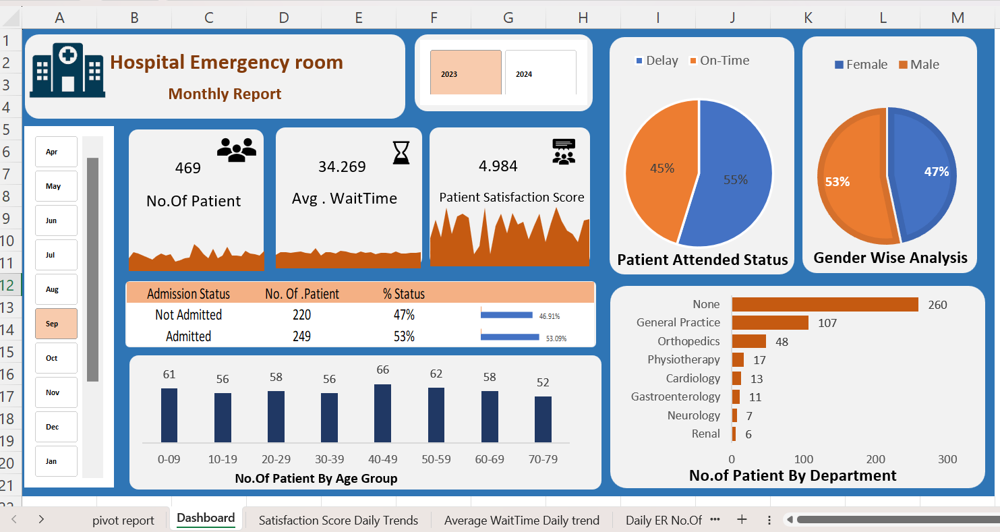

# 🏥 Hospital Emergency Room Analysis Dashboard

**Hospital Emergency Room Analysis using Microsoft Excel**

## 📌 Project Overview

This project focuses on analyzing Hospital Emergency Room (ER) data using Microsoft Excel to understand patient flow, admission patterns, service efficiency, patient demographics, and department referrals.

An interactive Excel dashboard was developed to monitor key performance indicators (KPIs), identify operational trends, and provide meaningful insights to support data-driven decision-making in healthcare management.

## 🎯 Business Objectives

- Analyze patient admission and attendance patterns.
- Monitor emergency room waiting time and service timeliness.
- Understand patient demographics based on age and gender.
- Identify department-wise patient referral trends.
- Evaluate patient satisfaction levels.
- Support healthcare stakeholders in improving operational efficiency and patient experience.

## 🛠 Skills & Tools Used

- Microsoft Excel
- Data Cleaning & Data Preparation
- Pivot Tables
- Pivot Charts
- KPI Development
- Data Visualization
- Dashboard Design
- Healthcare Data Analysis

## 📊 Key Performance Indicators (KPIs)

- **Total Number of Patients:** 469
- **Average Waiting Time:** 34.269
- **Patient Satisfaction Score:** 4.984
- **Patient Admission Status:** Admitted vs. Not Admitted
- **Service Timeliness:** Delay vs. On-Time
- **Gender-wise Patient Distribution**
- **Age Group-wise Patient Distribution**
- **Department-wise Patient Referrals**

## 📈 Dashboard Preview

## ✨ Dashboard Features

- Interactive monthly report dashboard.
- Year-based filtering for 2023 and 2024.
- Month-wise patient analysis.
- Patient admission status visualization.
- Gender-wise patient distribution.
- Age group-wise patient analysis.
- Department-wise referral analysis.
- Patient attended status analysis (Delay vs. On-Time).
- Patient satisfaction score monitoring.
- KPI cards for quick performance evaluation.

## 🔍 Key Insights

- Analyzed patient admission patterns, with 249 patients admitted and 220 not admitted.
- Identified the gender-wise patient distribution, with 53% male and 47% female patients.
- Evaluated service timeliness, with 55% categorized as Delay and 45% as On-Time.
- Analyzed patient distribution across different age groups, with the 40–49 age group recording the highest patient count.
- Identified department referral patterns, with the highest referral count under the "None" category, followed by General Practice.
- Monitored patient satisfaction using a dashboard KPI score of 4.984.

## 📁 Project Files

| File Name | Description |
|---|---|
| `Emergency_Room_DashBoard.xlsx` | Excel workbook containing the ER analysis, dashboard, pivot report, and trend analysis sheets |
| `DashBoard.png` | Dashboard screenshot for GitHub preview |
| `README.md` | Project documentation |

M.Sc. Computer Applications | Data Analytics

